# Suspicious PowerShell Investigation (Home SOC Lab)

## Summary

In this project, I created safe "suspicious" PowerShell activity in my Active Directory home lab. Then I acted as a SOC analyst and investigated it using Windows logs and Sysmon.

I found:
- An **encoded PowerShell command** that hid discovery commands (`whoami`, `hostname`)
- A **PowerShell download** from the internet using `Invoke-WebRequest`
- The full **process tree** (parent and child processes)
- The **network connection** and the **exact commands** that ran

All activity was harmless and done in an isolated lab for learning.

---

## Lab Environment

| Item | Details |
|---|---|
| Hypervisor | Oracle VirtualBox |
| Domain | `corp.local` |
| Domain Controller | DC01, Windows Server 2025 |
| Endpoint | CLIENT01, Windows 11 Pro (in the Workstations OU) |
| Logging | Windows Security log, Sysmon (SwiftOnSecurity config), PowerShell Operational log |

---

## Step 1: Logging Setup (Group Policy)

I created a GPO called **Lab-Workstation-Logging** and linked it to the **Workstations OU**. It turns on:

| Setting | Why it matters |
|---|---|
| Audit Process Creation (Success) | Creates **Event 4688** when a program starts |
| Include command line in process creation events | Shows the **full command** inside Event 4688 |
| Turn on PowerShell Script Block Logging | Creates **Event 4104** with the real PowerShell code, even if it was encoded |

I checked that it worked on CLIENT01:
- `gpupdate /force` and `gpresult /r /scope:computer` showed the GPO was applied
- `auditpol /get /subcategory:"Process Creation"` showed **Success**

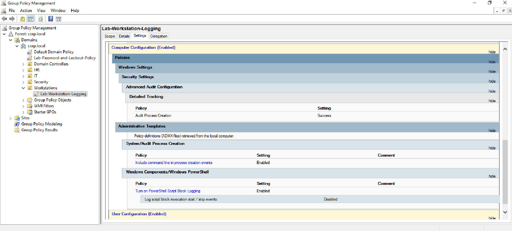
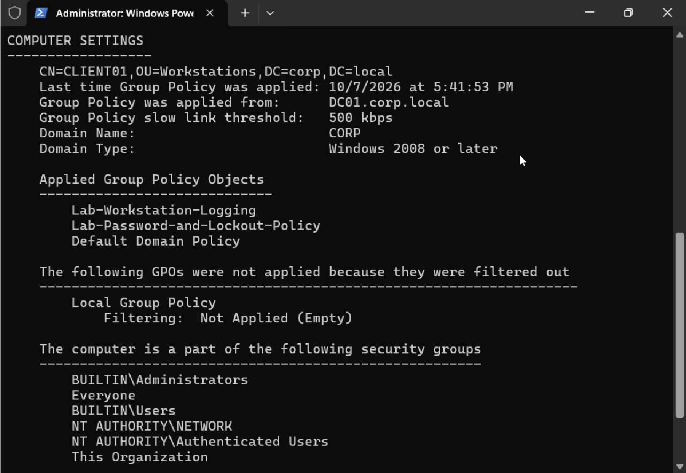
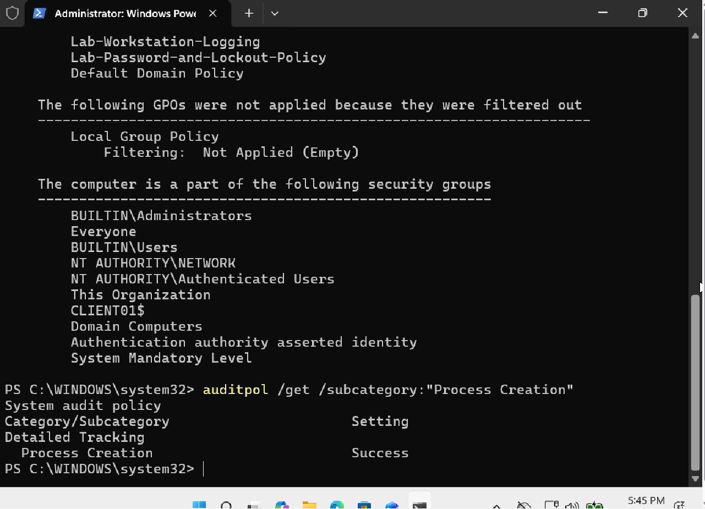

---

## Step 2: Sysmon Install

I installed **Sysmon64** on CLIENT01 with the SwiftOnSecurity configuration. Sysmon gives more detail than normal Windows logs, like parent processes, file hashes, and network connections.

```
.\Sysmon64.exe -accepteula -i sysmonconfig.xml
```

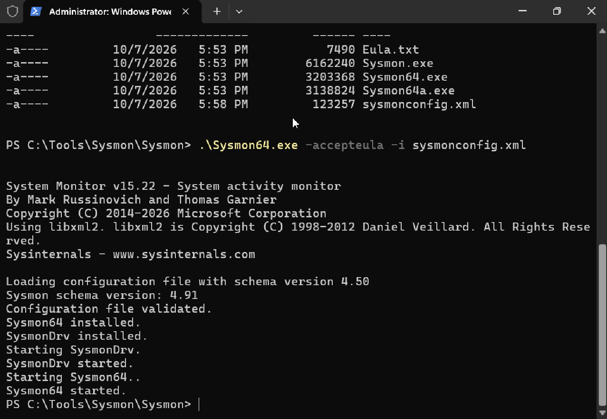
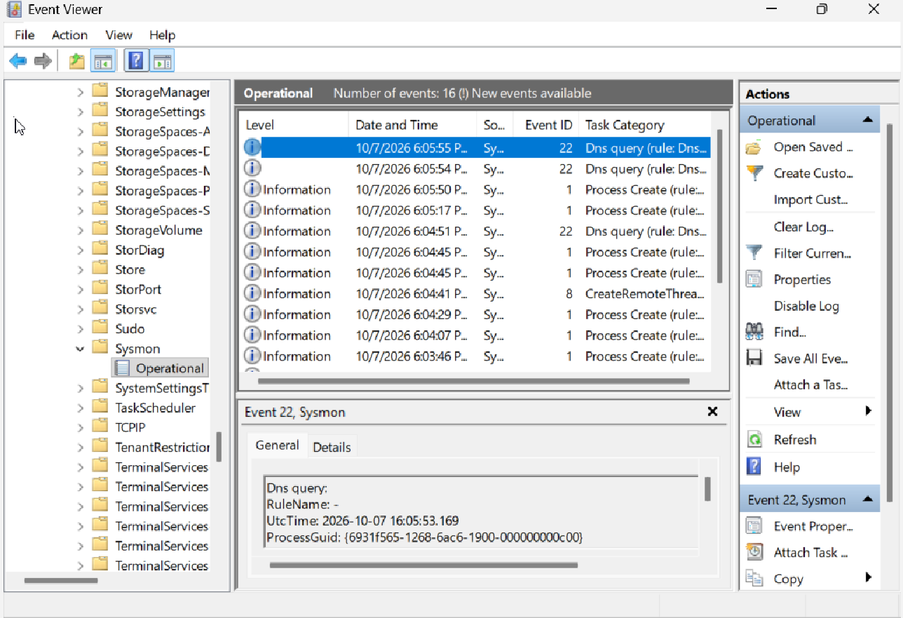

---

## Step 3: Simulated Activity (Safe Tests)

**Test 1: Encoded PowerShell command**

Attackers often encode commands in Base64 to hide them. I encoded two safe commands and ran them:

```
$cmd = 'whoami; hostname'
$enc = [Convert]::ToBase64String([Text.Encoding]::Unicode.GetBytes($cmd))
powershell.exe -NoProfile -EncodedCommand $enc
```

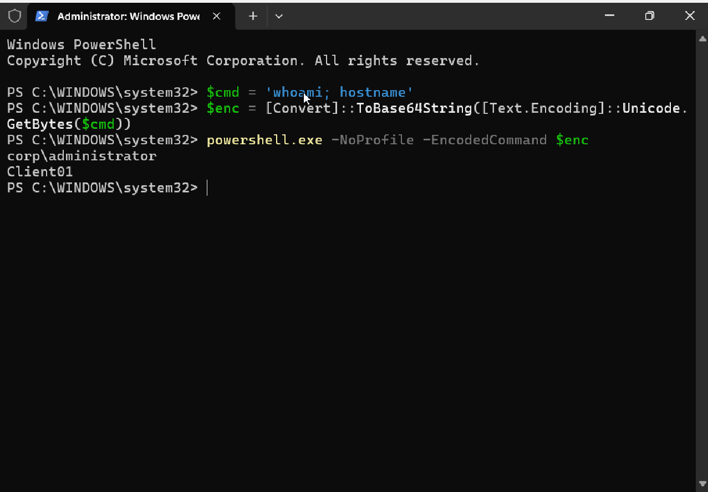

**Test 2: Download with PowerShell**

Attackers often use PowerShell to download tools. I downloaded a harmless web page:

```
Invoke-WebRequest -Uri "https://example.com" -OutFile "C:\Users\Public\test-download.html"
```

---

## Step 4: Investigation

### 4.1 Finding a suspicious child process (Sysmon Event 1)

I found `HOSTNAME.EXE` started by `powershell.exe` (Parent Process ID **900**), running as `CORP\Administrator` with **High** integrity.

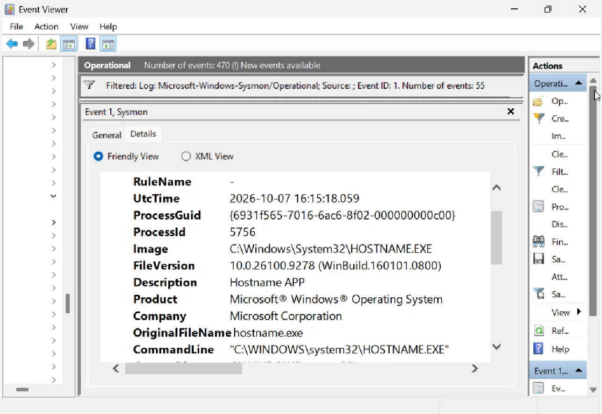


### 4.2 Finding the parent process (Sysmon Event 1)

I searched for Process ID 900. It was `powershell.exe`, started less than 1 second before `HOSTNAME.EXE`. Its command line had `-EncodedCommand` with a long Base64 string.

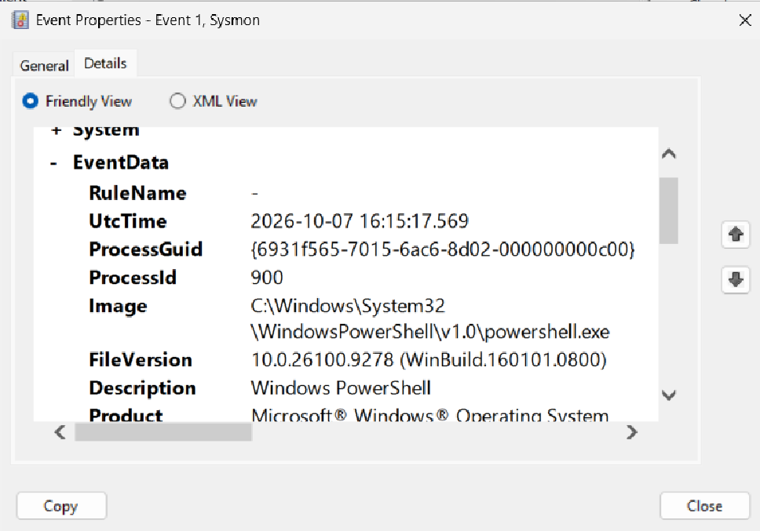


**Process tree:**

```
powershell.exe  (interactive admin console)
   └── powershell.exe  PID 900  (-NoProfile -EncodedCommand ...)
          ├── whoami.exe
          └── HOSTNAME.EXE
```

### 4.3 Decoding the hidden command

I copied the Base64 string from the log and decoded it:

```
[Text.Encoding]::Unicode.GetString([Convert]::FromBase64String('<Base64 string>'))
```

Result: `whoami; hostname`

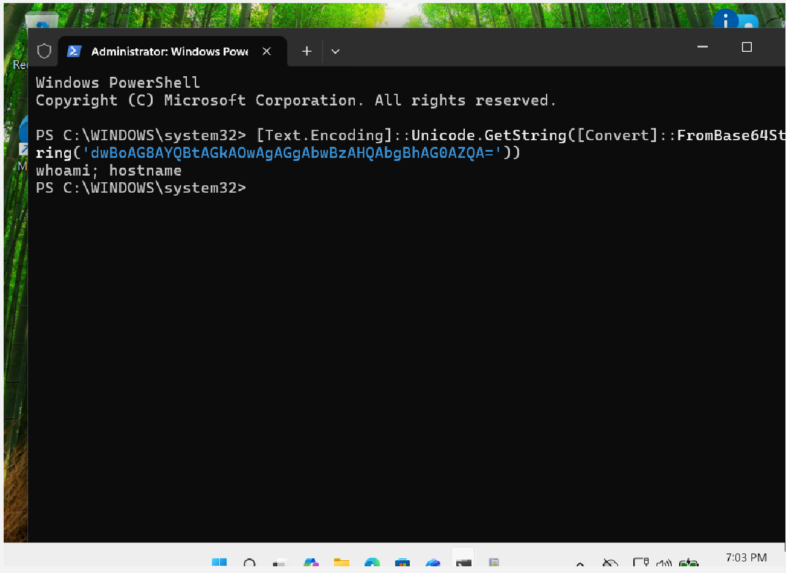

### 4.4 Network connection (Sysmon Event 3)

| Field | Value |
|---|---|
| Image | `powershell.exe` |
| Source IP | 10.0.2.15 (CLIENT01 NAT adapter) |
| Destination IP | 104.20.23.154 |
| Destination Port | 443 (HTTPS) |
| Initiated | true (outbound) |

The log did not include a host name, so I checked the IP with `Resolve-DnsName example.com`. The IP **104.20.23.154** belongs to **example.com**.

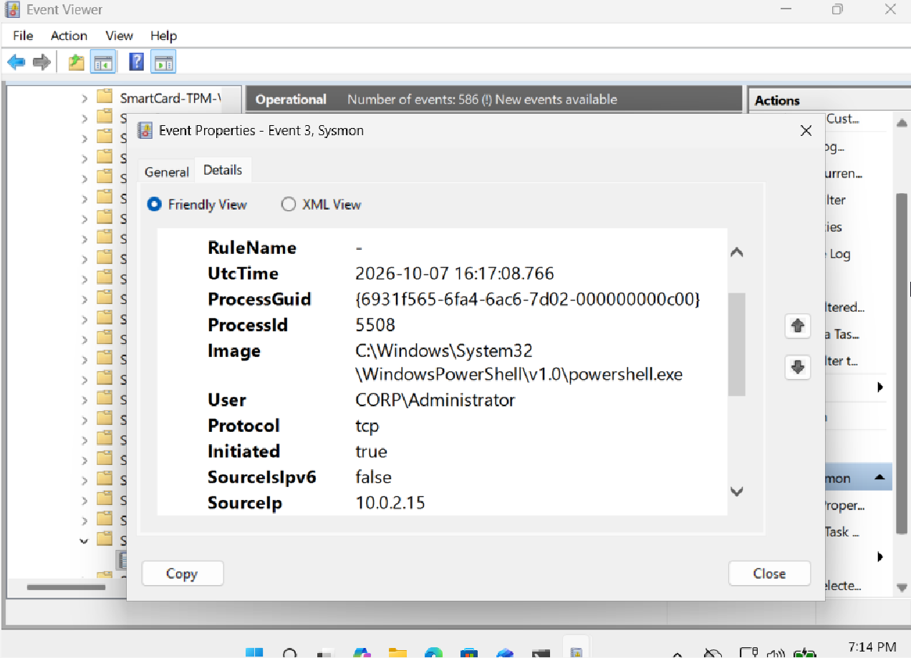
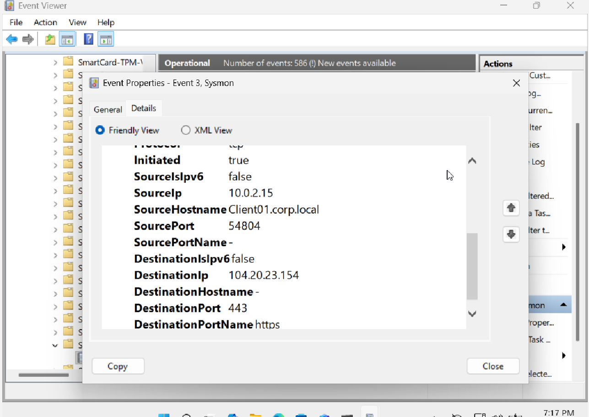


### 4.5 Exact commands (PowerShell Event 4104)

Script Block Logging recorded:
- The full `Invoke-WebRequest` command, with the URL and the output file path
- The **decoded** Test 1 command (`whoami; hostname`) in plain text. So an analyst can read hidden commands without decoding them by hand.

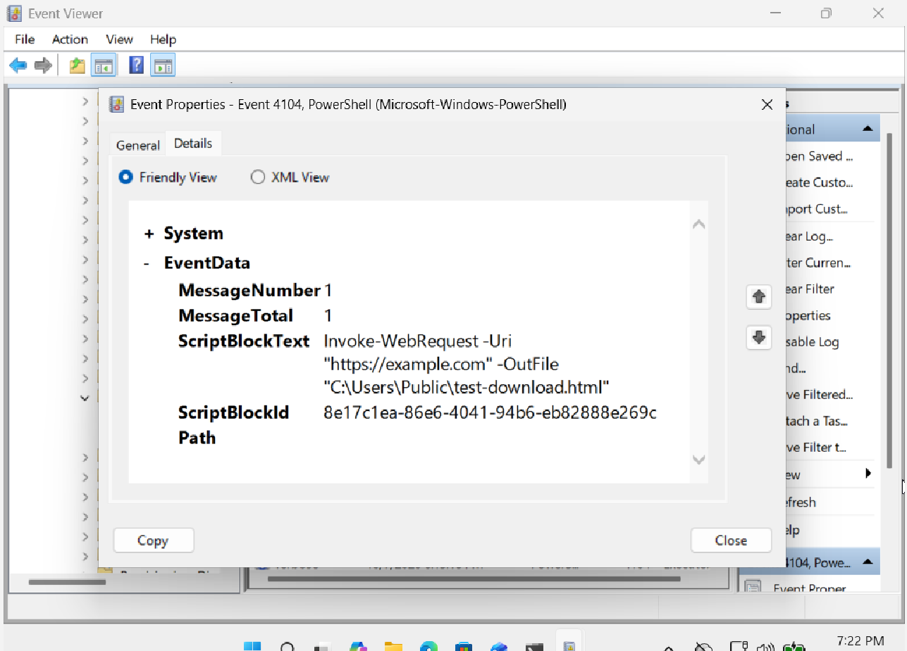
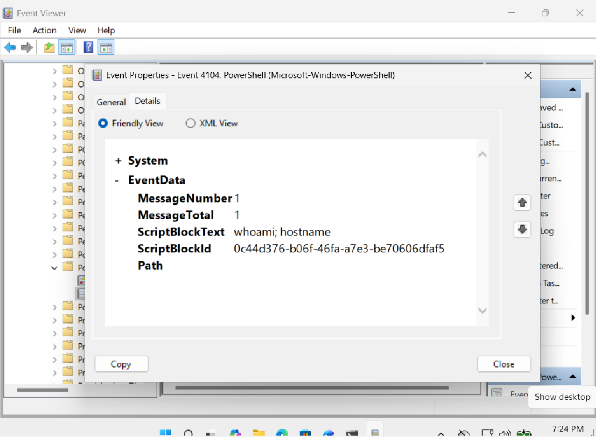

### 4.6 Native Windows evidence (Security Event 4688)

Event 4688 also showed the encoded PowerShell, its full command line, and its parent process. This is important because many organizations do not have Sysmon.

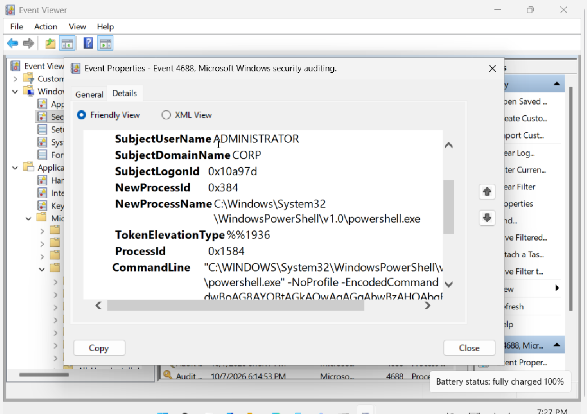

---

## Timeline

CLIENT01 clock is UTC+2.

| Time (UTC) | Time (CLIENT01) | Event |
|---|---|---|
| 16:15:17 | 18:15:17 | `powershell.exe` (PID 900) starts with `-EncodedCommand` |
| 16:15:18 | 18:15:18 | Child processes `whoami.exe` and `HOSTNAME.EXE` run |
| ~16:17 | ~18:17 | PowerShell connects to 104.20.23.154:443 (example.com) and saves `test-download.html` |

---

## MITRE ATT&CK Mapping

| Technique | ID | Evidence |
|---|---|---|
| Command and Scripting Interpreter: PowerShell | T1059.001 | PowerShell used for all activity |
| Obfuscated Files or Information | T1027 | `-EncodedCommand` with Base64 |
| System Owner/User Discovery | T1033 | `whoami.exe` |
| System Information Discovery | T1082 | `HOSTNAME.EXE` |
| Ingress Tool Transfer | T1105 | `Invoke-WebRequest` download |

---

## Indicators (IOCs)

| Type | Value |
|---|---|
| Host | CLIENT01.corp.local |
| User | CORP\Administrator |
| Process | `powershell.exe` with `-EncodedCommand` |
| Destination IP | 104.20.23.154 (example.com, port 443) |
| File | `C:\Users\Public\test-download.html` |

---

## Conclusion

This activity was a **planned test (true positive, authorized)**. In a real company, these signs would need quick action:
- PowerShell started by PowerShell with an encoded command
- Discovery commands right after
- An outbound download to a user-writable folder like `C:\Users\Public`

**Recommended response in a real case:**
1. Isolate the host from the network
2. Check if the admin account was compromised and reset its password
3. Block the destination IP or domain
4. Collect and check the downloaded file (hash it, scan it)
5. Search other hosts for the same command line and IP

---

## Detection Ideas

- Alert on `powershell.exe` with `-EncodedCommand`, `-enc`, or `-e` in the command line (Sysmon 1, Event 4688)
- Alert on PowerShell Event 4104 containing `Invoke-WebRequest`, `DownloadString`, or `DownloadFile`
- Alert on `powershell.exe` making outbound connections to the internet (Sysmon 3)

---

## What I Learned

- How to turn on process and PowerShell logging with Group Policy, and how to verify it
- The difference between Event Viewer (where you read logs) and Sysmon (a tool that writes extra logs)
- How to build a process tree using Process ID and Parent Process ID
- How to decode Base64 PowerShell commands
- Why Script Block Logging (4104) is so useful: it shows hidden commands in plain text
- How to prove which website an IP belongs to
- Why time zones matter when building a timeline

---

*All activity was performed in an isolated home lab for learning. No real systems were affected.*
